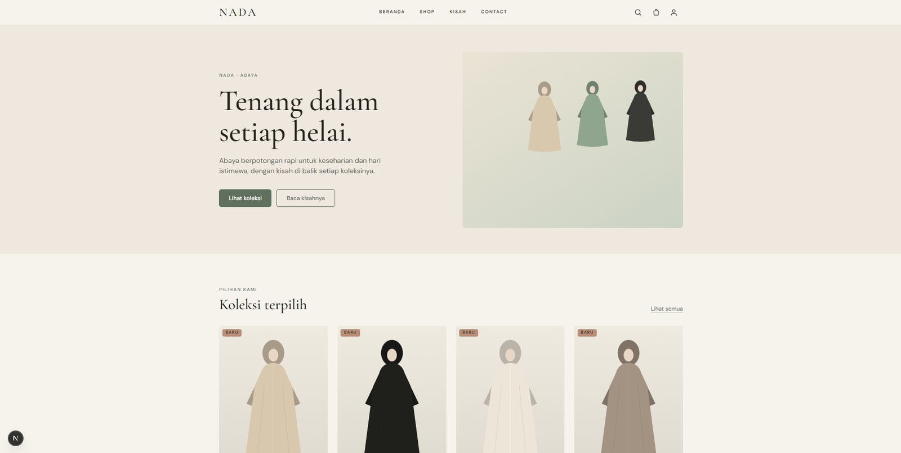
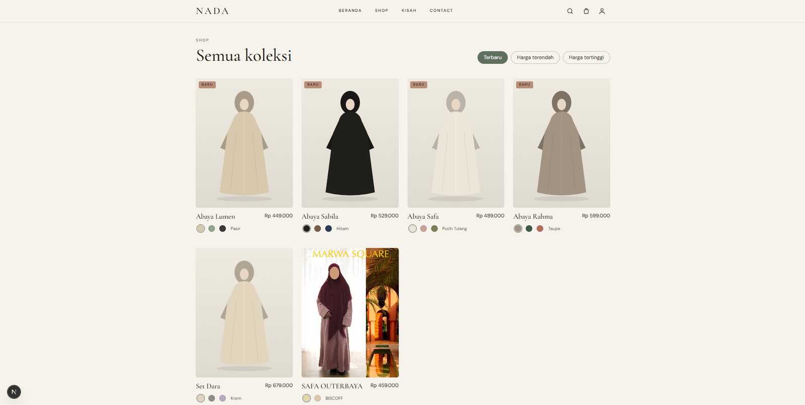
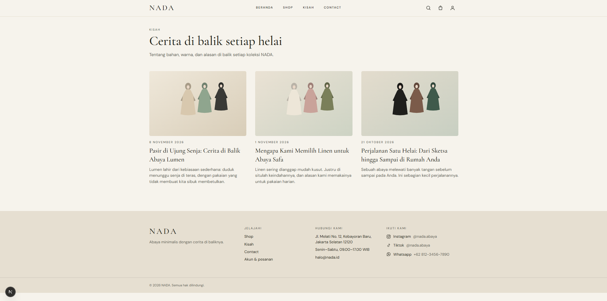
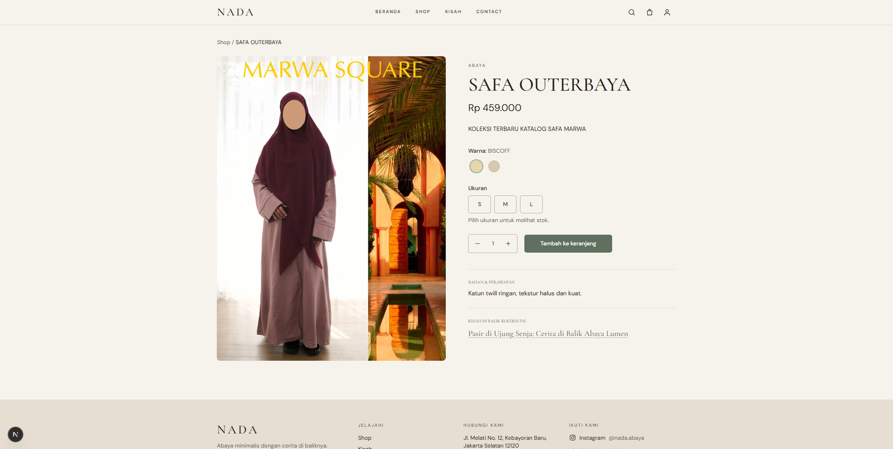
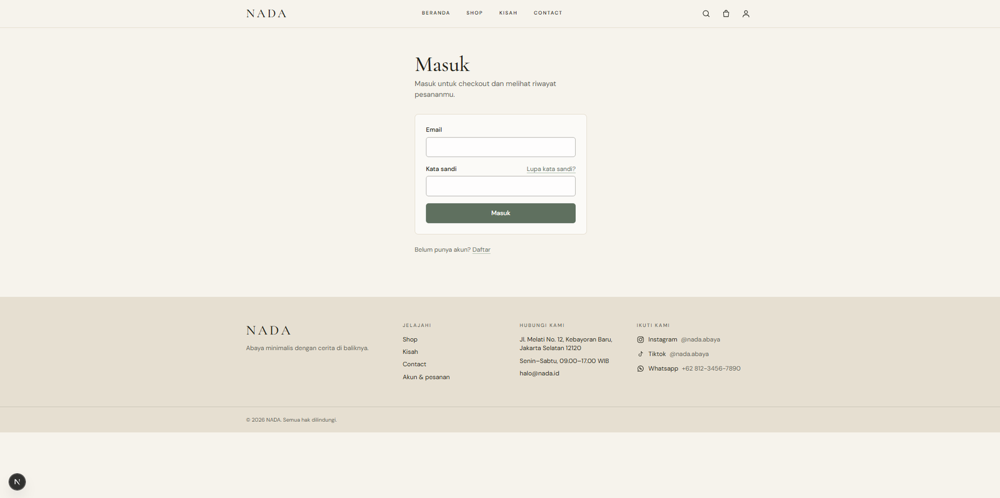
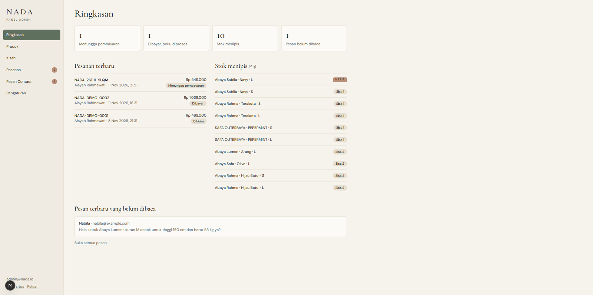
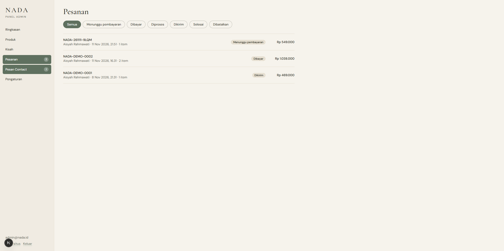
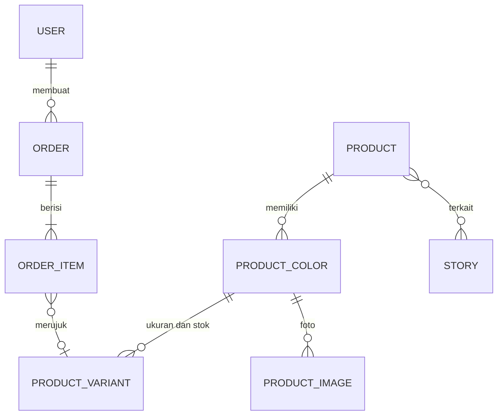

<div align="center">

# NADA

**E-commerce abaya minimalis dengan cerita di balik setiap koleksi.**


[Tampilan](#tampilan) · [Fitur](#fitur) · [Teknologi](#teknologi) · [Memulai](#memulai) · [Arsitektur](#arsitektur) · [Keamanan](#keamanan) · [Keterbatasan](#keterbatasan)

</div>



> **English summary.** NADA is a full-stack e-commerce web app for minimalist abayas, built with Next.js 15 (App Router), React 19, TypeScript, Tailwind CSS 4 and Prisma. It combines a product catalogue (per-colour photos, per-size stock, cart and checkout) with an editorial "Kisah" (stories) section and an admin CMS for products, stories, orders and customer messages. Built as a university capstone project at UPN Veteran Jakarta, with Claude (Anthropic) as an AI pair-programming contributor.

## Tentang proyek

NADA memadukan **katalog belanja** dengan **cerita** di balik setiap koleksi, sehingga pembeli tidak hanya melihat produk tetapi juga memahami bahan, warna, dan alasan di baliknya. Pemilik toko mengelola semuanya lewat panel admin tanpa menyentuh kode.

Proyek ini dibuat untuk mata kuliah **Capstone** di UPN Veteran Jakarta dan mengikuti dokumen *PRD NADA — E-Commerce Abaya (MVP)*. Proyek dikembangkan dengan bantuan **Claude (Anthropic)** sebagai asisten pemrograman AI.

## Tampilan

### Sisi pembeli

| Beranda | Shop |
| :---: | :---: |
|  |  |
| **Kisah** | **Detail produk** |
|  |  |

<p align="center">
  
</p>

### Panel admin

| Ringkasan | Pesanan |
| :---: | :---: |
|  |  |

## Fitur

| ID | Fitur | Keterangan | Lokasi kode |
| --- | --- | --- | --- |
| F1 | Autentikasi | Daftar, masuk, lupa sandi; akun admin terpisah di `/admin/login` | `src/actions/auth.ts` |
| F2 | Beranda | Hero, produk terpilih (ditandai admin), kisah terbaru, media sosial | `src/app/(site)/page.tsx` |
| F3 | Kisah | Daftar dan detail `/kisah/[slug]`, tautan ke produk terkait | `src/app/(site)/kisah` |
| F4 | Contact | Formulir dengan validasi, honeypot, dan batas per IP; WhatsApp, alamat, jam layanan | `src/app/(site)/contact` |
| F5 | Shop | Swatch warna mengganti foto, stok per warna dan ukuran, keranjang, checkout, status pesanan | `src/app/(site)/shop`, `cart`, `checkout`, `akun` |
| F6 | Kisah terbaru | Tiga kisah terbit terbaru tampil otomatis di Beranda | halaman Beranda |
| F7 | Pencarian | Saran saat mengetik dan halaman hasil (produk dan kisah) | `SearchBar.tsx`, `/search` |
| F8 | Media sosial | Ditampilkan di Beranda dan footer, diatur lewat admin | `SiteSettings` |
| F9 | CMS admin | Ringkasan, produk (varian warna + foto), kisah (editor teks), pesanan, pesan, pengaturan | `src/app/admin` |

## Teknologi

| Lapisan | Teknologi |
| --- | --- |
| Framework | Next.js 15 (App Router, Server Actions), React 19 |
| Bahasa | TypeScript |
| Tampilan | Tailwind CSS 4 |
| Database & ORM | Prisma 6 dengan SQLite (dapat diganti PostgreSQL, lihat [Database lain](#database-lain)) |
| Autentikasi | Sesi JWT (`jose`) di cookie `httpOnly`, kata sandi di-hash dengan `bcryptjs` |
| Validasi | `zod`; HTML kisah disanitasi dengan `sanitize-html` |
| Gambar | `sharp` (validasi isi berkas, perkecil maks. 1600 px, ubah ke WebP) |
| Email | `nodemailer` (SMTP, opsional) |
| Pembayaran | Midtrans Snap (opsional) atau transfer manual + konfirmasi WhatsApp |

## Memulai

**Prasyarat:** Node.js 18.18 atau lebih baru (disarankan 20 LTS) dan npm.

```bash
# 1. Ambil kode dan pasang dependensi
git clone https://github.com/ahmadrifqi12/nada-abaya-ecommerce.git
cd nada-abaya-ecommerce
npm install

# 2. Buat berkas konfigurasi lokal
cp .env.example .env          # Windows PowerShell: Copy-Item .env.example .env

# 3. Buat kunci rahasia acak, lalu tempel ke AUTH_SECRET di .env
node -e "console.log(require('crypto').randomBytes(32).toString('hex'))"

# 4. Buat database dan isi data contoh
npm run setup

# 5. Jalankan
npm run dev                   # http://localhost:3000
```

Untuk produksi: `npm run build && npm start`.

### Akun contoh

Setelah `npm run setup`, akun **admin** dan **pembeli** contoh dicetak di terminal (lihat juga `prisma/seed.ts`). Pembeli masuk lewat `/masuk`, admin lewat `/admin/login`.

> [!WARNING]
> Akun contoh hanya untuk lokal. **Ganti atau hapus sebelum di-deploy**, dan pastikan `AUTH_SECRET` produksi adalah string acak yang berbeda dari lingkungan lokal.

### Variabel lingkungan

| Variabel | Wajib | Keterangan |
| --- | :---: | --- |
| `DATABASE_URL` | Ya | Default `file:./dev.db` (SQLite) |
| `AUTH_SECRET` | Ya | Penanda sesi login (JWT). Minimal 32 karakter acak. Jangan pernah di-commit |
| `APP_URL` | Ya | Alamat publik situs, dipakai untuk tautan reset sandi, sitemap, dan callback pembayaran |
| `MIDTRANS_SERVER_KEY` | Tidak | Kosong berarti transfer manual + konfirmasi WhatsApp |
| `MIDTRANS_IS_PRODUCTION` | Tidak | `"true"` hanya untuk produksi |
| `SMTP_HOST`, `SMTP_PORT`, `SMTP_USER`, `SMTP_PASS`, `SMTP_FROM` | Tidak | Kosong berarti tautan reset sandi dicetak di konsol server |

### Skrip npm

| Perintah | Fungsi |
| --- | --- |
| `npm run dev` | Server pengembangan |
| `npm run build` | `prisma generate` lalu build produksi |
| `npm start` | Menjalankan hasil build |
| `npm run typecheck` | Pemeriksaan tipe TypeScript |
| `npm run db:push` | Menerapkan skema ke database |
| `npm run db:seed` | Mengisi data contoh. Menolak berjalan bila database sudah berisi data; `-- --force` menghapus semuanya |
| `npm run setup` | `generate` + `db:push` + `db:seed` sekaligus |

## Arsitektur

```
prisma/            skema database + seed
src/
├─ app/
│  ├─ (site)/      halaman pembeli (beranda, shop, kisah, contact, akun, checkout)
│  ├─ admin/       panel admin
│  ├─ api/         search, cart, upload, webhook pembayaran
│  └─ uploads/     rute penyaji foto (dilindungi dari path traversal)
├─ actions/        server actions (auth, shop, admin)
├─ components/     komponen UI (+ components/admin)
├─ lib/            db, auth/jwt, katalog, pesanan, pengaturan, gambar, Midtrans, mail, rate limit
└─ middleware.ts   penjaga rute /admin, /checkout, /akun
data/uploads/      foto produk dan kisah (tidak masuk git)
```

### Model data

Foto dan stok dipisah agar tidak dobel: foto melekat pada **warna**, stok melekat pada **ukuran** dalam warna itu.



Tabel lain: `Message` (pesan dari formulir Contact) dan `SiteSetting` (pengaturan situs).

### Keputusan desain

- **Ukuran:** S, M, L (ubah di `src/lib/constants.ts`).
- **Checkout wajib login.**
- **Pembayaran:** Midtrans Snap bila `MIDTRANS_SERVER_KEY` diisi (webhook `POST /api/payment/notification`). Bila kosong, otomatis transfer manual + konfirmasi WhatsApp, dan admin menandai pesanan "Dibayar".
- **Ongkos kirim:** tarif tetap (opsional gratis ongkir di atas nominal tertentu), diatur di Pengaturan situs. Belum memakai API kurir.
- **Foto:** disimpan di disk lokal (`data/uploads`). Di hosting serverless atau ephemeral, ganti `saveImage` di `src/lib/images.ts` dengan Cloudinary atau S3.
- **Gambar contoh** pada data seed adalah ilustrasi SVG buatan skrip. Ganti dengan foto asli lewat CMS (rasio 3:4, latar netral).
- **Lupa kata sandi:** mengirim email lewat SMTP bila `SMTP_*` diisi; bila kosong, tautan dicetak di konsol server.

### Database lain

Default-nya SQLite agar langsung jalan tanpa instalasi. Untuk PostgreSQL:

1. Ubah `provider = "postgresql"` di `prisma/schema.prisma`.
2. Isi `DATABASE_URL` dengan connection string PostgreSQL.
3. Jalankan `npx prisma db push`.
4. Tambahkan `mode: "insensitive"` pada pencarian di `src/lib/catalog.ts` (di SQLite sudah tidak peka huruf besar-kecil).

Prisma juga mendukung MySQL (`provider = "mysql"`), tetapi proyek ini **belum diuji** dengan MySQL.

## Keamanan

- Kata sandi di-hash dengan bcrypt; sesi JWT disimpan di cookie `httpOnly` dengan `sameSite=lax`.
- Peran admin dicek di middleware **dan** di setiap halaman, action, dan API admin.
- Batas percobaan login dan batas pengiriman formulir per IP.
- Respons lupa sandi tidak membocorkan apakah email terdaftar.
- Stok dikurangi di dalam transaksi database.
- HTML kisah disanitasi di server; unggahan divalidasi dari isi berkas dan dibatasi 8 MB; rute berkas dilindungi dari path traversal.
- Parameter `?next=` hanya menerima jalur internal.
- Webhook Midtrans memverifikasi signature (SHA-512).
- Header keamanan dasar (`X-Content-Type-Options`, `X-Frame-Options`, `Referrer-Policy`) dan `X-Powered-By` dimatikan.
- Berkas rahasia (`.env`, `*.db`, `data/`) diabaikan git. Hanya `.env.example` yang boleh masuk repositori.

## Keterbatasan

Catatan jujur tentang yang belum ada:

- Pesanan berstatus "Menunggu pembayaran" **belum kedaluwarsa otomatis**. Stok kembali bila pembeli atau admin membatalkan, atau Midtrans mengirim `expire`.
- Pembatas login tersimpan di memori satu server. Untuk beberapa instance, gunakan Redis.
- Cadangan database berkala, HTTPS, dan pendaftaran sitemap di Search Console diurus saat deploy.
- Pencarian memakai `contains`; full-text search belum dipakai.
- Audit kontras warna belum menyeluruh dan Lighthouse belum dijalankan. Teks sekunder memakai `#5E5E55` (rasio sekitar 4,5:1 atau lebih); warna `#8C8C82` hanya untuk garis dan placeholder.
- Belum ada pengujian otomatis.

## Penulis

**Ahmad Rifqi Abduh Falah** — Sistem Informasi, UPN Veteran Jakarta · [@ahmadrifqi12](https://github.com/ahmadrifqi12)

Dikembangkan dengan bantuan Claude (Anthropic) sebagai AI pair-programmer.

## Lisensi

Belum dilisensikan. Kode dibagikan untuk keperluan akademik dan portofolio; hubungi penulis sebelum memakainya ulang.
